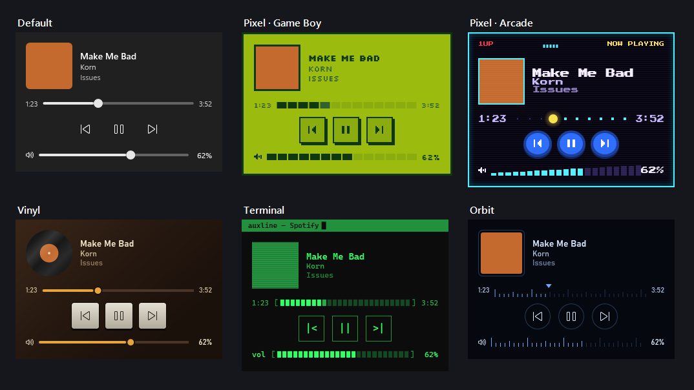
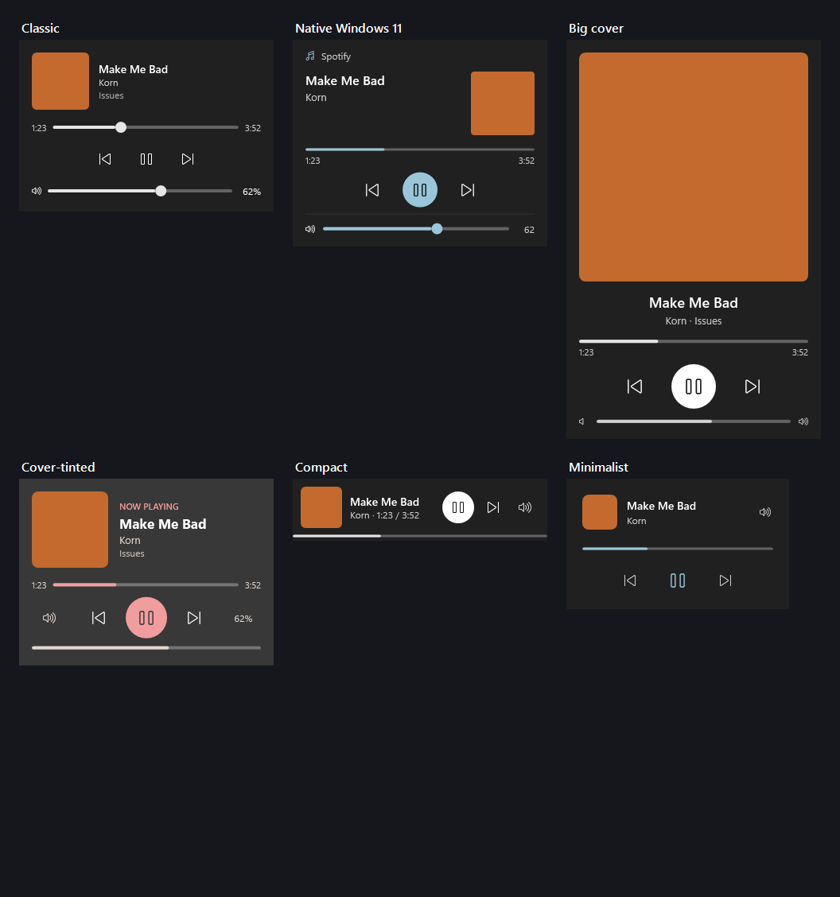

<p align="center">
  
</p>

<h1 align="center">Auxline</h1>

<p align="center">
  A small, customizable media widget for the Windows 11 taskbar.
</p>

<p align="center">
  <a href="https://github.com/ksadowy/Auxline/releases/latest"></a>
  <a href="https://github.com/ksadowy/Auxline/actions/workflows/release.yml"></a>
  <a href="LICENSE"></a>
  
  
</p>

Auxline shows what's playing (cover, title, artist) right on your taskbar, in the free space next to your app icons.
Click it for a flyout with playback controls, a progress bar and the app's own volume.

It works with Spotify and anything else that reports to Windows' media controls: browsers (YouTube, SoundCloud, …),
media players and so on. No accounts or API keys, nothing is sent anywhere.



---

## Features

**On the taskbar**
- Cover thumbnail, title and artist, sized to fit and never covering taskbar icons
- A small **music meter** next to the title that moves with how loud the music plays
- Left of the taskbar icons or right of them (next to the tray), with an adjustable distance and maximum width
- Any monitor's taskbar; follows display, scaling and taskbar changes; top, left and right taskbars too
- Hides for fullscreen apps and games, and when the taskbar auto-hides

**The flyout** (click the widget)
- Play/pause, previous, next; progress bar with seeking (when the app reports its timeline)
- Volume of the playing app only, not the whole system
- Six **styles** (layouts): Classic, Native Windows 11, Big cover, Cover-tinted (colours from the album art), Compact, Minimalist
- Six **themes** (looks, for any style): Default (Windows 11, light/dark, acrylic), Pixel · Game Boy, Pixel · Arcade,
  Vinyl, Terminal and Orbit, with small animations while music plays



**Sources and settings**
- Choose which apps Auxline follows and which one wins when several play (e.g. Spotify before the browser)
- Font, text sizes and colour of the widget; corners and acrylic of the flyout; light or dark
- Starts with Windows (optional), lives in the notification area, light on resources: everything is event-driven and
  the frequent updates (progress bar, meter) only run while they're visible and music plays

---

## Install

1. Download `Auxline-Setup-<version>.exe` from the [latest release](https://github.com/ksadowy/Auxline/releases/latest).
2. Run it. It installs for your user only (`%LocalAppData%\Programs\Auxline`), no admin rights needed, and can start
   Auxline when you sign in.

The installer isn't code-signed, so Windows SmartScreen may warn about an unrecognized app: choose
**More info → Run anyway**.

Requires Windows 11 (x64). Everything the app needs is included; no separate .NET install.

To uninstall: **Settings → Apps → Installed apps → Auxline**. Your settings stay in `%AppData%\Auxline` (delete the
folder to reset them); logs are in `%LocalAppData%\Auxline\logs`.

---

## Using it

- **Click the widget** to open the flyout; click again, press Esc or click elsewhere to close it.
- **Right-click the tray icon** for Settings, Start with Windows and Exit.
- **Settings**
  - *Position*: monitor, left or right of the icons, distance, maximum width, cover size
  - *Appearance*: flyout style and theme, music meter, light/dark, font and sizes, widget text colour, flyout corners
    and acrylic. Every change applies immediately.
  - *Sources*: every app that has played media, with on/off switches and a priority order

### Live progress bar in Firefox-based browsers

Firefox, Zen, LibreWolf and other Firefox-based browsers only report the playback position when you pause or resume, so
the progress bar shows up late. [`extras/firefox-position-state.user.js`](extras/firefox-position-state.user.js) fixes
that:

1. Install a userscript manager, e.g. [Violentmonkey](https://addons.mozilla.org/firefox/addon/violentmonkey/).
2. Create a new script and paste the file's contents (or open the raw file URL to install it).
3. Restart the browser or reload media tabs.

It calls `navigator.mediaSession.setPositionState()` when media starts, pauses, seeks or changes speed, plus every
5 s while playing. It sends nothing anywhere and needs no permissions (`@grant none`). Chromium-based browsers don't
need it.

### Known limitations

- **Not built into the taskbar.** Windows 11 has no API for that (deskbands are gone), so Auxline is a separate window
  kept on top of the taskbar.
- **Per app, not per site.** Windows reports the browser, not the website, so sources are chosen per app.
- **Opera / Opera GX** probably won't get volume control: their Start menu entry points to `launcher.exe`, while audio
  plays from `opera.exe` (untested).
- **Top, left and right taskbars** need unofficial tweaks or tools on Windows 11 (e.g. ExplorerPatcher, Windhawk).
  Auxline adapts to them (flyout below or beside the widget, just the cover on vertical taskbars), but they get less
  testing.
- **The music meter** follows the app's sound before its mixer volume, so an app muted in the Windows mixer still
  moves it.

---

## How it works

| Area | How |
|---|---|
| Language / UI | C# on .NET 10, WPF, MVVM with [CommunityToolkit.Mvvm](https://github.com/CommunityToolkit/dotnet) |
| Track info and controls | `Windows.Media.Control` (Global System Media Transport Controls), event-driven |
| Per-app volume and meter | Windows Core Audio sessions via [NAudio](https://github.com/naudio/NAudio): `SimpleAudioVolume`, `AudioMeterInformation` |
| Placement on the taskbar | Win32: owned by the taskbar window, app bar notifications (fullscreen), WinEvent hooks (auto-hide, foreground), UI Automation to find the taskbar buttons it must not cover |
| Flyout styles and themes | One XAML layout per style (`Views/FlyoutStyles`), one resource dictionary per theme (`Views/Themes`); layouts only use theme keys, so any theme fits any style |
| Tray icon | [H.NotifyIcon](https://github.com/HavenDV/H.NotifyIcon) with a native menu |
| Settings | JSON in `%AppData%\Auxline\settings.json`, applied live |

---

## Building from source

Requirements: Windows 11, the [.NET 10 SDK](https://dotnet.microsoft.com/download), and for the installer
[Inno Setup 6](https://jrsoftware.org/isdl.php).

```powershell
git clone https://github.com/ksadowy/Auxline.git
cd Auxline
dotnet run --project Auxline     # run it
dotnet test Auxline.slnx         # tests
```

- `tools/build-release.ps1 -Version 1.2.0` builds the installer into `artifacts/` (self-contained publish + Inno Setup,
  script in `installer/Auxline.iss`).
- `tools/build-icons.ps1` renders the logo and icons (`assets/logo`, `Auxline/Assets`) from the shapes in the script.
- The tests render every flyout style in every theme; set `AUXLINE_RENDER_DIR` to a folder to also save them as PNGs.

### Releasing

Push an annotated version tag:

```powershell
git tag -a v1.2.0 -m "Auxline 1.2.0"
git push origin v1.2.0
```

The [release workflow](.github/workflows/release.yml) checks that the tag is annotated, runs the tests, builds the
installer and creates a **draft** GitHub release with it and generated notes, ready to review and publish. A tag with a
suffix (`v1.2.0-beta.1`) becomes a pre-release.

---

## License

[MIT](LICENSE) © Krzysztof Sadowy.

The pixel themes use the fonts [Silkscreen](https://github.com/googlefonts/silkscreen) and
[Press Start 2P](https://github.com/google/fonts/tree/main/ofl/pressstart2p), under the SIL Open Font License
(`Auxline/Fonts`).
